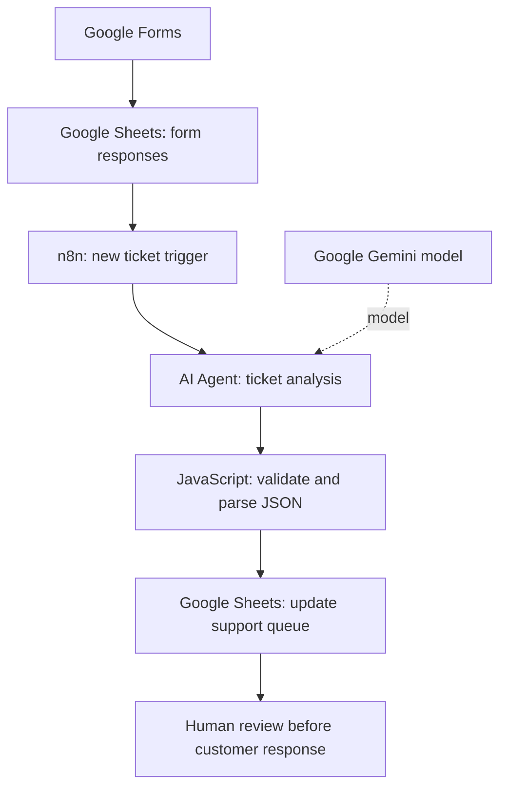

# CareFlow Health — AI-Assisted Support Ticket Triage

**Portfolio project by Oluwaseun Aribisogan**  
**Tools:** n8n · Google Sheets · Google Gemini · JavaScript · JSON · Google Forms

> **Project status:** Portfolio prototype / workflow template. The exported workflow shows the intended automation pattern. Reconnect credentials, select a test spreadsheet, and complete the test checklist before using it. CareFlow Health is a fictional scenario, not a client deployment.

## Problem

Support teams regularly read incoming requests, identify the issue, decide how to categorise it and prepare a first response. Repeating these steps manually can slow initial triage and produce inconsistent ticket records.

## Proposed solution

This workflow uses AI to assist the early stages of ticket review while keeping a person responsible for reviewing customer-facing communication.

1. A customer submits a request through Google Forms.
2. Google Forms stores the response in Google Sheets.
3. The n8n Google Sheets Trigger detects the new row.
4. Google Gemini analyses the submitted details and returns structured suggestions.
5. A JavaScript Code node validates and parses the response.
6. n8n writes the summary, category, sentiment, draft reply and pending status to the support queue.
7. A support representative reviews the record and draft before responding.

## Workflow architecture

## Fields produced

| Field | Purpose |
|---|---|
| Customer name | Carries the submitted customer name into the processed record |
| Summary | Concise model-generated description of the issue |
| Category | Suggested ticket category |
| Sentiment | Suggested customer sentiment |
| Draft reply | Response draft for a support representative to review |
| Status | Set to Pending for human review |

The customer's submitted priority is retained as source data. This template does not infer or overwrite priority.

## Repository contents

- `CareFlow Health - AI Ticket Triage & Customer Support Automation.json` — sanitised n8n workflow template.
- [`docs/architecture.md`](docs/architecture.md) — system components and data flow.
- [`docs/workflow-review.md`](docs/workflow-review.md) — implementation notes and acceptance checklist.
- [`docs/data-dictionary.md`](docs/data-dictionary.md) — source and output fields.
- [`docs/setup-and-handover.md`](docs/setup-and-handover.md) — import and configuration guidance.
- [`docs/privacy-and-safety.md`](docs/privacy-and-safety.md) — safe sharing and human-review controls.
- [`tests/test-scenarios.md`](tests/test-scenarios.md) — test cases to run in a test workspace.
- [`samples/`](samples/) — synthetic example input and output.
- [`screenshots/`](screenshots/) — workflow and interface visuals.

## Important implementation notes

The workflow export is configured with dynamic prompt expressions and output field mappings. The template still requires environment-specific configuration and a complete end-to-end run in your own n8n workspace. The checklist records what to validate before treating it as operational.

No time-saving, accuracy, satisfaction or cost-reduction metric is claimed for this prototype.

## Privacy and safety

- The workflow export uses placeholders rather than a private Google Sheet ID or saved credential references.
- Reconnect Google Sheets and Gemini credentials through n8n's credential manager.
- Use synthetic form submissions for testing and public screenshots.
- Keep AI-generated summaries and draft replies subject to human review.
- Do not publish real customer records, credential values or private business data.

## About

**Oluwaseun Aribisogan**  
Business Analysis · AI Automation · Data Analytics

- [LinkedIn](https://www.linkedin.com/in/oluwaseun-aribisogan)
- [GitHub](https://github.com/oluwaseun-tech)
- [Email](mailto:odunayoluwaseun@gmail.com)

Lagos, Nigeria · Open to international remote opportunities and project collaborations.
