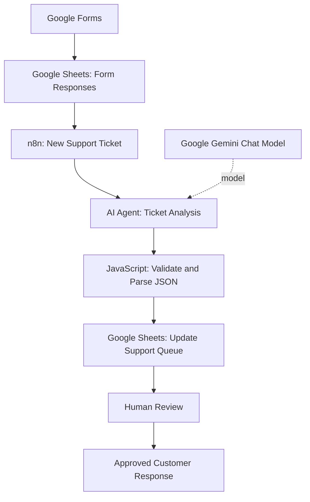

# CareFlow Health — AI-Assisted Support Ticket Triage

**Portfolio case study by Oluwaseun Aribisogan**  
**Tools:** n8n · Google Sheets · Google Gemini · JavaScript · JSON · Google Forms

> **Project status:** Portfolio prototype. The public workflow export has been sanitised and its prompt, parsing and known output mappings have been improved. It still requires account reconnection, field/tab selection and end-to-end testing in the user's own n8n workspace before operational use. CareFlow Health is a fictional scenario, not a client deployment.

## The business problem

Support teams repeatedly read incoming requests, interpret the issue, assign categories, assess urgency and prepare an initial response. When these steps are handled manually, ticket triage can become inconsistent and time-consuming.

This case study explores an AI-assisted intake and triage process that structures requests for support-team review while keeping customer communication under human control.

## Proposed workflow

1. A customer submits a request through Google Forms.
2. Google Forms records the response in a Google Sheet.
3. The n8n Google Sheets Trigger detects the new row.
4. Google Gemini analyses the current incoming ticket using the trigger data.
5. A JavaScript Code node validates and parses the model's JSON output.
6. The Google Sheets node writes the mapped AI summary, category, sentiment, draft reply and review status to the support queue.
7. A support representative reviews the draft before any customer communication is sent.

## Architecture

## Current workflow components

| Component | Responsibility |
|---|---|
| Google Forms | Captures support-request details |
| Google Sheets | Stores form responses and triage fields |
| n8n | Orchestrates the automation |
| Google Gemini | Produces an AI-assisted analysis |
| JavaScript Code node | Validates and parses the model response |
| Human reviewer | Checks the AI suggestions and approves any response |

## Fields produced by the model

The current prompt requests:

- `customer_name`
- `summary`
- `category`
- `sentiment`
- `draft_reply`

The existing sheet schema has columns for AI Summary, AI Category, AI Sentiment, AI Draft Reply and Status, but no separate AI Priority column. The workflow therefore treats the customer's submitted priority as source data and does not ask the model to generate or overwrite a priority.

## Implementation notes

The public workflow export now uses expressions to read the current trigger item rather than a fixed sample customer. The parsing step checks for empty or malformed model output and missing required fields before the sheet-update node runs. The known AI output fields are mapped to their matching support-queue columns.

The Google Sheet identifier, selected tab and credential references have been removed from the public export. After importing, reconnect Google Sheets and Gemini credentials and select your own test spreadsheet and form-response tab.

See:
- [Workflow review and acceptance checklist](docs/workflow-review.md)
- [Architecture and data flow](docs/architecture.md)
- [Data dictionary](docs/data-dictionary.md)
- [Setup and handover](docs/setup-and-handover.md)
- [Privacy and safe sharing](docs/privacy-and-safety.md)
- [Test scenarios](tests/test-scenarios.md)

## Screenshots

- [Google Form intake](screenshots/google-form.JPG)
- [Google Sheets support queue](screenshots/google-sheet.JPG)
- [n8n workflow screenshot](screenshots/n8n%20json.JPG)

## Business value

The intended benefits are more structured ticket records, faster initial review, consistent summaries and category suggestions, and draft responses that support agents can edit before sending.

No measured time-saving, accuracy, customer-satisfaction or cost-reduction result is claimed for this prototype. Those outcomes would need to be assessed through a controlled pilot with agreed baseline metrics.

## Future enhancements

- Add a distinct AI Priority field only if the support team later requires a model-suggested priority and the spreadsheet schema is deliberately updated.
- Add an explicit human approval step and audit trail.
- Route malformed output and provider failures to a visible exception queue.
- Add service-level monitoring and operational reporting.
- Connect approved tickets to a CRM or help-desk platform.

## About

**Oluwaseun Aribisogan**  
Business Analysis · AI Automation · Data Analytics

- [LinkedIn](https://www.linkedin.com/in/oluwaseun-aribisogan)
- [GitHub](https://github.com/oluwaseun-tech)
- Email: [odunayoluwaseun@gmail.com](mailto:odunayoluwaseun@gmail.com)

Based in Lagos, Nigeria.
