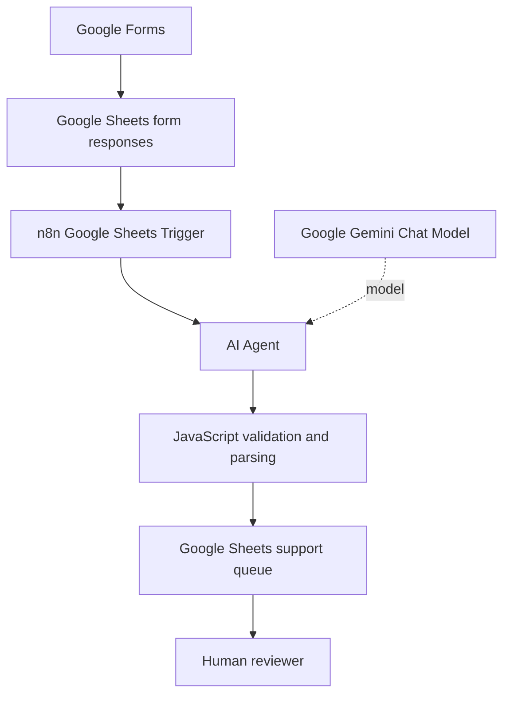

# Architecture

## Data flow

## Components

| Component | Responsibility |
|---|---|
| Google Forms | Collects support-request details |
| Google Sheets | Stores form submissions and processed triage fields |
| n8n | Orchestrates the trigger, AI call, parsing and sheet update |
| Google Gemini | Suggests a structured summary, category, sentiment and draft |
| JavaScript | Validates and parses the model response |
| Human reviewer | Checks AI suggestions and owns customer communication |

## Control points

- Dynamic prompt expressions read the current trigger item.
- The Code node rejects missing, malformed or incomplete AI output.
- The Sheets node updates the matching row using Timestamp.
- AI-generated text remains a suggestion; customer communication is not sent automatically.
- The customer's original priority is retained as source data.
