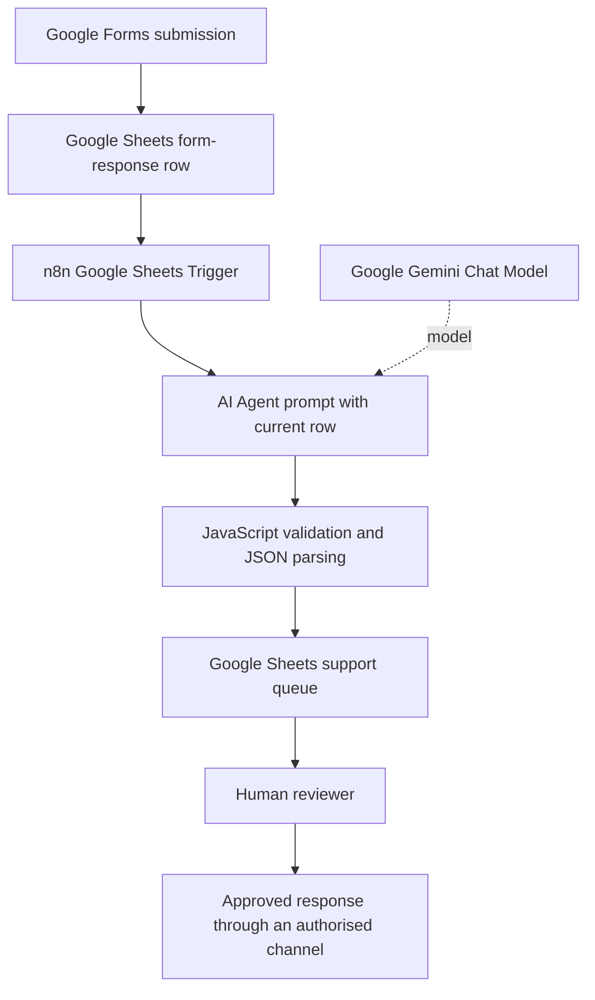

# Architecture

## Data flow

## Components

| Component | Responsibility |
|---|---|
| Google Forms | Collects support-request details |
| Google Sheets | Stores form responses and triage fields |
| n8n | Triggers and orchestrates the workflow |
| Google Gemini | Suggests a structured ticket analysis |
| JavaScript Code node | Validates and parses the model response |
| Human reviewer | Checks category, summary, priority suggestion and draft response |

## Model response contract

The prompt requests `customer_name`, `summary`, `category`, `priority`, `sentiment` and `draft_reply`.

The existing sheet schema supports AI Summary, AI Category, AI Sentiment, AI Draft Reply and Status. It does not have a dedicated AI Priority column. The incoming customer-submitted priority must not be silently replaced by an AI-generated value.

## Control points

- Treat model output as an assistant-generated suggestion, not verified fact.
- Validate JSON before writing values to the tracking sheet.
- Surface parse failures and provider errors to an operator.
- Keep customer communication under human control.
- Keep personal data and private account identifiers out of public workflow exports.
